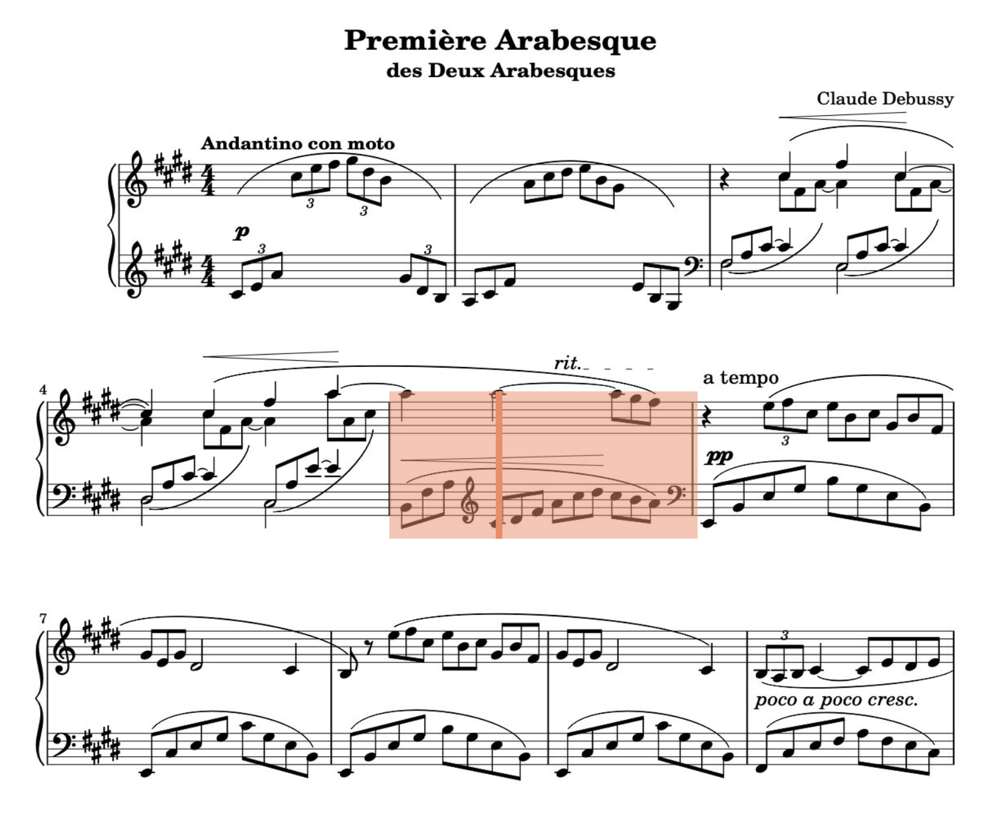
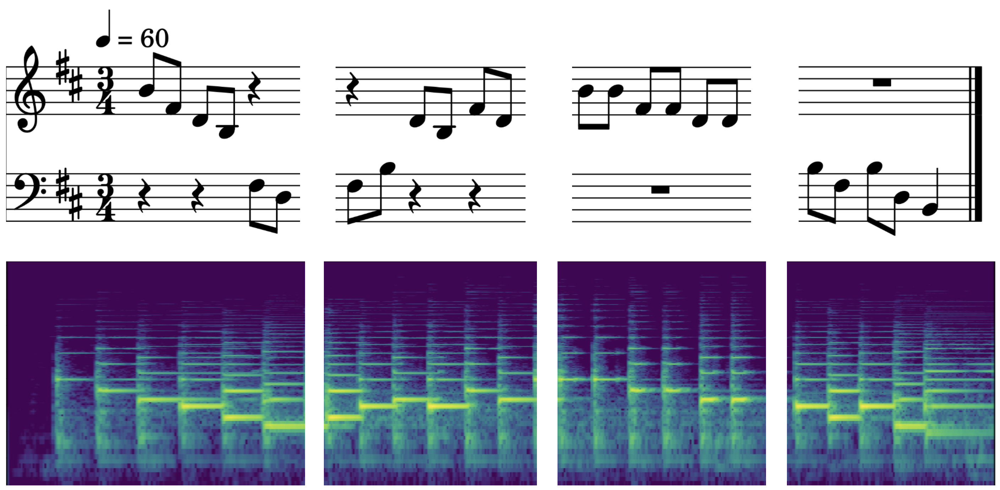
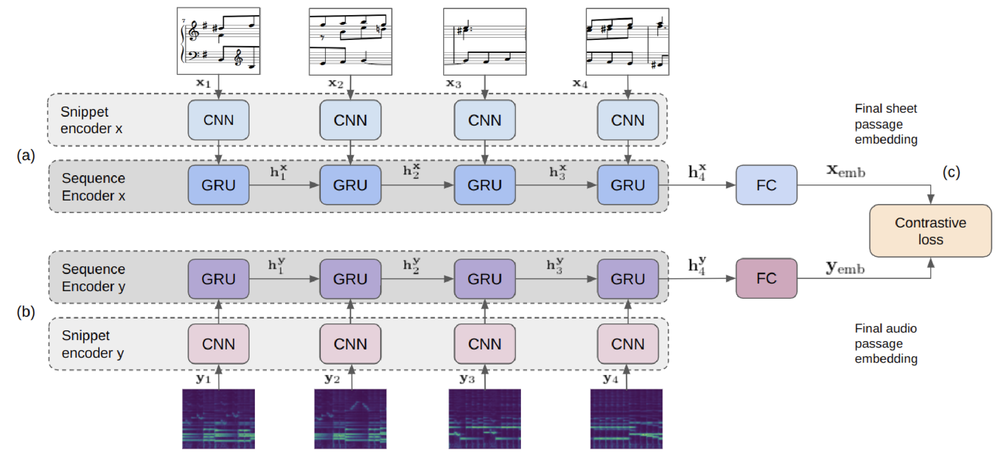
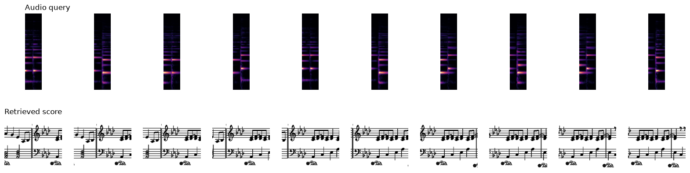

# Enhance Musical Practice through Musical Audio-to-Score Alignment

This project tackles the problem of locating the current position in a music score from audio, using a cross-modal recurrent network, and tests it in conditions close to real practice.

Master's thesis, MSc Artificial Intelligence, Maastricht University, 2024.


_The goal of score following: show musicians where they are in the score as they play (Debussy, Première Arabesque)._


_One of my test pieces: each bar of the score (top) and the matching audio (bottom)._

## Overview

Musicians practicing with paper or a tablet have to turn pages or
scroll, which breaks their flow. Score following, which automatically tracks where the player is in the score, could remove that interruption. Recent deep-learning methods can match audio to sheet-music images directly. They have been tested on clean performances, but not on the conditions of real practice: raw recordings and playing mistakes.

This project re-implements the cross-modal recurrent network of [Carvalho & Widmer (2023)](https://arxiv.org/abs/2309.12111) in PyTorch and evaluates it in practice-like conditions:

- **Encoders:** separate VGG-style CNNs embed each sheet snippet (160×180 px)
  and spectrogram excerpt (92×20 px)
- **Sequence model:** one GRU per modality (128 hidden units) summarises a
  sequence of snippets into a passage embedding
- **Loss:** triplet contrastive loss pulls matching audio/sheet passages
  together and pushes non-matching ones apart (K = 15 negatives, margin α = 0.05)
- **Training:** MSMD (360 pieces, 70/30 train/val split), 100 epochs, multi-GPU
  with DistributedDataParallel
- **Test set:** three new 4-bar piano pieces that I composed (1 monophonic, 2 polyphonic),
  each recorded correctly, with one wrong note per bar, and with one rhythm
  error per bar


_Architecture, from Carvalho & Widmer (2023)._

## My contributions

The original code by Dorfer et al. is in `audio_sheet_retrieval/`. Everything below is my own work:

- **PyTorch re-implementation** (`thesis/modules/`): the CNN encoders, the GRU sequence models, the triplet contrastive loss, the dataset class and a trainer for multi-GPU training with `torchrun` and DistributedDataParallel, with a CPU fallback.
- **Command-line scripts** (`thesis/scripts/`): dataset creation, train/validation splits, training, and testing with a plot of the retrieved score.
- **Evaluation:** R@1, R@10, MRR and MR for each condition, compared with Mann-Whitney U tests.
- **Practice-like test set:** three new 4-bar piano pieces, each recorded in 3 ways: played correctly, with one wrong note per bar and with one rhythm error per bar. They are then converted to MSMD format with my own pipeline.
- **Fixes to existing code:** a snippet-boundary bug in the original `data_pools.py`, a gradient bug in my triplet loss, and a port of the msmd library to Python 3.12 and NumPy 2 in [my fork](https://github.com/Puma1208/msmd/tree/thesis).
- **Tests:** pytest tests for the dataset class, run on a small generated dataset.

## Results

> These results come from models that did not learn properly: after submitting the thesis, I found a bug in my loss function (it turned values into plain Python numbers with `.item()`, which disconnected the loss from the model). The [fix](https://github.com/Puma1208/thesis-audio-sheet-retrieval/commit/4a2d0e8) keeps the whole computation in tensors so gradients now reach all 52 parameter tensors.
> The numbers below are as reported in the thesis. The comparisons between conditions say more about the test data than about the method.

Mean scores on the test set (higher is better for R@k and MRR, lower for MR):

| Setting                                                                                    | R@1   | R@10  | MRR   | MR   |
| ------------------------------------------------------------------------------------------ | ----- | ----- | ----- | ---- |
| Real audio                                                                                 | 0.074 | 0.674 | 0.225 | 8.11 |
| Synthetic audio                                                                            | 0.074 | 0.672 | 0.217 | 8.42 |
| Monophonic                                                                                 | 0.056 | 0.546 | 0.188 | 9.61 |
| Polyphonic                                                                                 | 0.083 | 0.736 | 0.243 | 7.40 |
| Correct performance                                                                        | 0.078 | 0.682 | 0.231 | 8.13 |
| One wrong note per bar                                                                     | 0.078 | 0.639 | 0.216 | 8.42 |
| One rhythm error per bar                                                                   | 0.067 | 0.698 | 0.217 | 8.24 |
| Baseline: RNN-FT ([Carvalho & Widmer, 2023](https://arxiv.org/abs/2309.12111)), real audio | 0.224 | 0.395 | 0.338 | 18   |

Key findings (Mann-Whitney U, α = 0.01):

- No significant difference between real and synthetic audio
- No significant drop with one wrong note or one rhythm error per bar
- Significantly better on polyphonic than monophonic music

> Note: the test pieces are short (~18.5 snippets per piece), so R@10 and MR
> are not directly comparable to the baseline, which was evaluated on full-length
> pieces.

## Installation

Requires [conda](https://docs.conda.io/en/latest/miniconda.html). Tested with Python 3.12 and PyTorch 2.15.

```bash
git clone https://github.com/Puma1208/thesis-audio-sheet-retrieval.git
cd thesis-audio-sheet-retrieval
conda env create -f environment.yaml
conda activate thesis_msmd
pip install -e .
```

Check the installation by running the tests:

```bash
python -m pytest tests/
```

## Usage

Run all commands from the repository root.

1. **Download MSMD.** Get [`msmd_aug_v1-1_no-audio.zip`](https://zenodo.org/record/2597505/files/msmd_aug_v1-1_no-audio.zip?download=1) from Zenodo and unzip it. The zip is about 9.6 GB.

2. **Cut the pieces into snippets:**

   ```bash
   python -m thesis.scripts.create_dataset --msmd_root path/to/msmd_aug_v1-1_no-audio --output_dir path/to/snippets
   ```

3. **Split into training and validation sets.** The splits used in the thesis are already in `data/splits/`, and this step overwrites them, so skip it to reuse them:

   ```bash
   python -m thesis.scripts.create_splits --data_dir path/to/snippets
   ```

4. **Train.** Set `--nproc_per_node` to the number of GPUs. Without a GPU, use 1 and training runs on the CPU:

   ```bash
   torchrun --nproc_per_node=1 -m thesis.scripts.train --data_dir path/to/snippets --total_epochs 100
   ```

   The model is saved as `snapshot_GPU_0_<...>.pt` in the repository root. Metrics go to `metrics_DDP/` and TensorBoard logs to `runs/` (view them with `tensorboard --logdir runs`).

5. **Test** a saved model and plot one retrieval:

   ```bash
   python -m thesis.scripts.test --data_dir path/to/snippets --model_path snapshot_GPU_0_<...>.pt --plot retrieval.png
   ```

   
   _Example output of `--plot`, from a model trained before the loss fix: an audio query (top) and the score passage the model ranked closest (bottom)._

## License

The code I wrote for this thesis, in `thesis/` and `tests/`, is released under the [MIT License](LICENSE).

The rest of the repository is not covered by it:

- `audio_sheet_retrieval/` is the original code by Dorfer et al. from [CPJKU/audio_sheet_retrieval](https://github.com/CPJKU/audio_sheet_retrieval). That repository has no license, so its authors keep all rights.
- [msmd](https://github.com/CPJKU/msmd), which this project installs to build the MSMD dataset, is licensed under [CC BY-NC-SA 4.0](https://creativecommons.org/licenses/by-nc-sa/4.0/).

## Acknowledgements

This project builds on the code of [CPJKU/audio_sheet_retrieval](https://github.com/CPJKU/audio_sheet_retrieval) and the [MSMD dataset](https://github.com/CPJKU/msmd) by Dorfer et al. from the Institute of Computational Perception at JKU Linz. Their original README is kept in [docs/ORIGINAL_README.md](docs/ORIGINAL_README.md).

The model is a PyTorch re-implementation of:

- L. Carvalho and G. Widmer. [Passage Summarization with Recurrent Models for Audio–Sheet Music Retrieval](https://arxiv.org/abs/2309.12111). In _Proceedings of the International Society for Music Information Retrieval Conference (ISMIR)_, 2023.

The original code and dataset come from:

- M. Dorfer, J. Hajič jr., A. Arzt, H. Frostel, and G. Widmer. [Learning Audio–Sheet Music Correspondences for Cross-Modal Retrieval and Piece Identification](https://transactions.ismir.net/articles/10.5334/tismir.12/). _Transactions of the International Society for Music Information Retrieval_, 2018.
- M. Dorfer, A. Arzt, and G. Widmer. [Learning Audio–Sheet Music Correspondences for Score Identification and Offline Alignment](https://arxiv.org/abs/1707.09887). In _Proceedings of the International Society for Music Information Retrieval Conference (ISMIR)_, 2017.
- M. Dorfer, J. Schlüter, A. Vall, F. Korzeniowski, and G. Widmer. [End-to-End Cross-Modality Retrieval with CCA Projections and Pairwise Ranking Loss](https://link.springer.com/article/10.1007/s13735-018-0151-5). _International Journal of Multimedia Information Retrieval_, 2018.
